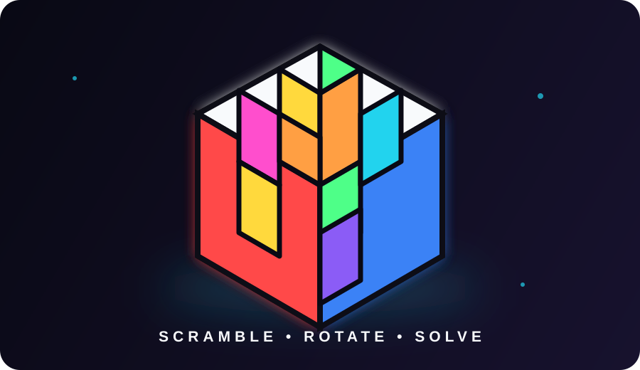
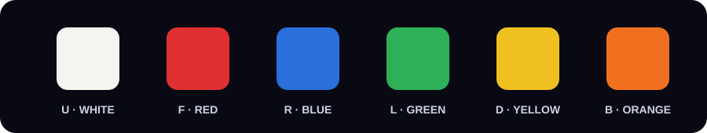

<div align="center">



# 🧩 THE CUBE

### A colorful 3D Rubik’s Cube simulator — scramble it, rotate it, theme it, solve it.


<br />


[🚀 **Play the Live Demo**](https://cube-project.vercel.app/) · [📦 **View the Repository**](https://github.com/SairajAgawane/cube-project)

</div>


## ✨ FEATURES

| Feature | What it does |
|---|---|
| 🎲 **Multi-size cubes** | Choose between 2×2, 3×3, 4×4, or 5×5. Each size tracks its own stats independently. |
| 🎨 **Five built-in themes** | Switch between Cube, Erno, Dust, Camo, and Rain palettes in a single tap. |
| 🖌️ **Custom theme editor** | Use the HSL color picker to tune the color of any cube face. |
| ⏱️ **Timer & statistics** | Tracks solves, best time, Ao5, Ao12, and Ao25. Data persists across sessions. |
| 🔀 **Automatic scrambler** | Choose Easy, Medium, or Hard with WCA-style move notation. |
| ⚙️ **Three flip animations** | Choose Swift, Smooth, or Bounce camera transitions from orthographic to wide FOV. |
| 📱 **Touch & mouse controls** | Drag on a face to rotate a layer; drag outside the cube to rotate the whole cube. |
| 🎉 **Solve celebration** | Trigger a confetti particle burst and best-time trophy when the cube is solved. |


## 🎮 HOW TO PLAY

Double-tap the cube to begin. The timer starts on your first move. Solve all six faces to win.

| Action | Gesture / control |
|---|---|
| Rotate a layer | `Drag` on a cube face |
| Rotate the whole cube | `Drag` outside the cube |
| Start a new game | `Double-tap` the cube |
| Open settings | `⚙️` icon — bottom right |
| View stats | `🏆` icon — bottom left |
| Back to menu | `←` back icon |


## 🎨 THEMES & CUSTOMIZATION

Five curated palettes give the simulator different personalities, while the custom HSL editor lets you tune individual face colors.



| Face | Position | Default color |
|---|---|---|
| U | Top | ⬜ White (`#f5f5f0`) |
| F | Front | 🟥 Red (`#e03030`) |
| R | Right | 🟦 Blue (`#2a6fdb`) |
| L | Left | 🟩 Green (`#2db058`) |
| D | Bottom | 🟨 Yellow (`#f0c020`) |
| B | Back | 🟧 Orange (`#f07020`) |


## 🏆 STATS & RECORDS

All statistics are tracked per cube size and saved automatically to `localStorage` — no account required.

| Record | Meaning |
|---|---|
| ✅ **Solves** | Number of completed solves |
| 🥇 **Best** | Personal best time |
| 📈 **Ao5** | Rolling average of five solves |
| 📊 **Ao12** | Rolling average of twelve solves |
| 🔢 **Ao25** | Rolling average of twenty-five solves |


## 🛠️ TECHNOLOGY STACK

| Technology | Role |
|---|---|
| [Three.js r95](https://threejs.org/) | 3D scene, camera, lighting, geometry, and cube rendering |
| Vanilla JavaScript (ES6+) | Game logic and interaction state |
| CSS3 animations | Interface transitions and responsive presentation |
| WebGL | Browser graphics backend |
| `requestAnimationFrame` | Render and animation loop |
| `localStorage` | Stats and settings persistence |
| Vercel | Live deployment |


## 📁 PROJECT STRUCTURE

No build step is required.

```text
cube-project/
├── index.html          # App shell and UI markup
├── style.css           # Fonts, sliders, layout, and responsive styling
├── script.js           # Full game logic
│   ├── AnimationEngine # rAF loop and tweening
│   ├── World           # Three.js scene, camera, and lighting
│   ├── Cube            # 3D model and geometry
│   ├── Controls        # Drag, touch, and layer rotation
│   ├── Scrambler       # Move generation and notation
│   ├── Timer           # Game clock
│   ├── Scores          # Stats and averages
│   ├── Storage         # localStorage persistence
│   ├── Themes          # Color schemes
│   └── Confetti         # Celebration particles
├── readme-assets/
│   ├── hero-cube.svg
│   ├── theme-palette.svg
│   └── neon-separator.svg
└── README.md
```


## 🚀 RUN LOCALLY

No build tools are required. Clone the repository and serve the static files.

```bash
git clone https://github.com/SairajAgawane/cube-project.git
cd cube-project

# Option 1: static server through npx
npx serve .

# Option 2: Python's built-in server
python -m http.server 8080
```

Then open the URL printed by your local server.

### Deploy to Vercel

```bash
npm install -g vercel
vercel
```

The live deployment is available at [cube-project.vercel.app](https://cube-project.vercel.app/).


## 📄 LICENSE

This project is released under the [MIT License](https://opensource.org/licenses/MIT).

<div align="center">

Built with ❤️ and [Three.js](https://threejs.org/) · Inspired by Ernő Rubik (1974)

[🚀 cube-project.vercel.app](https://cube-project.vercel.app/)

</div>

